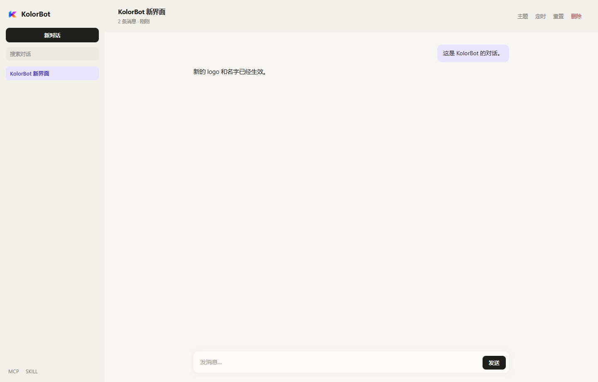
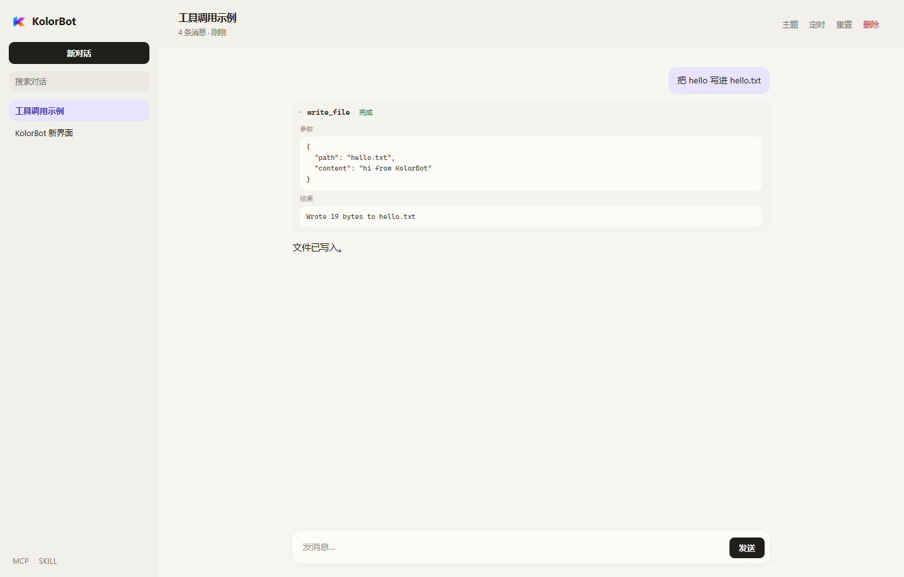
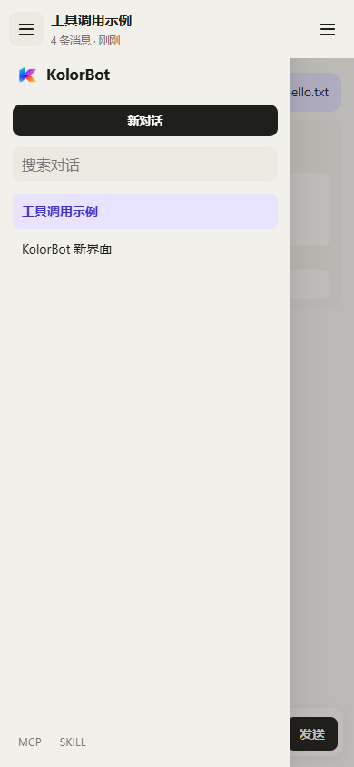
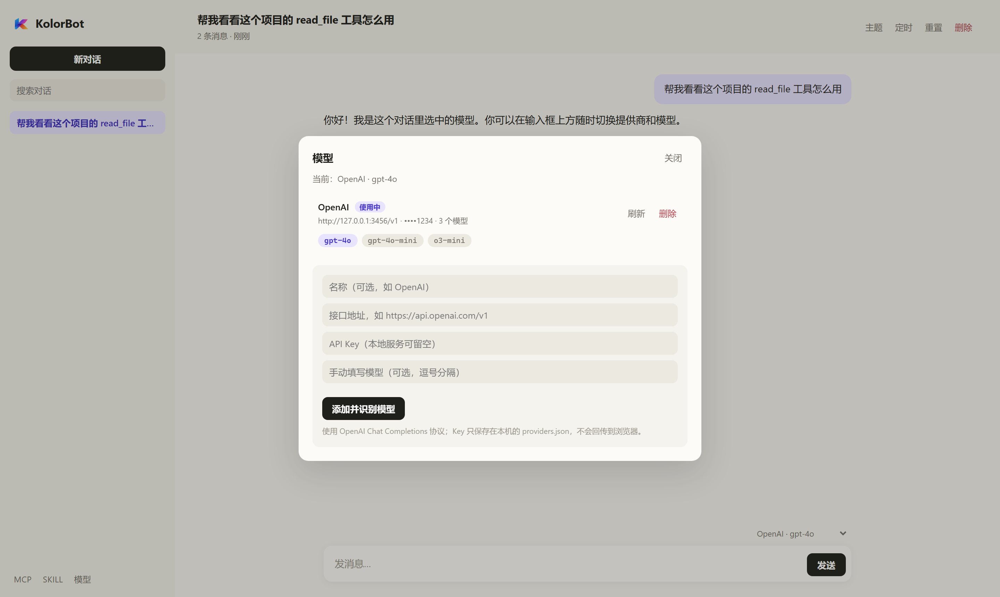
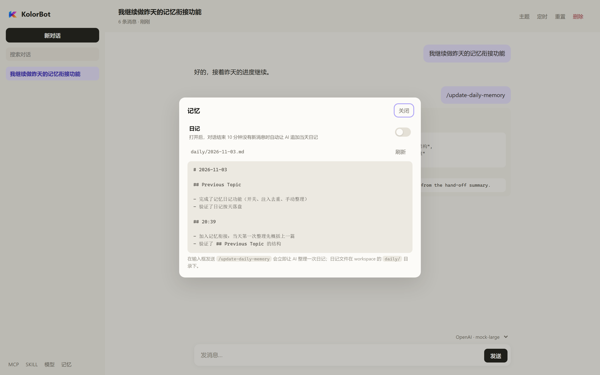
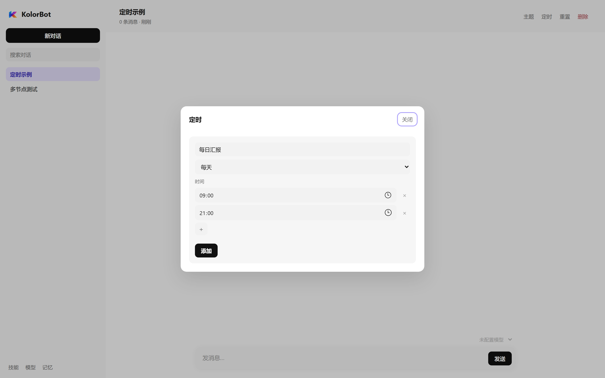
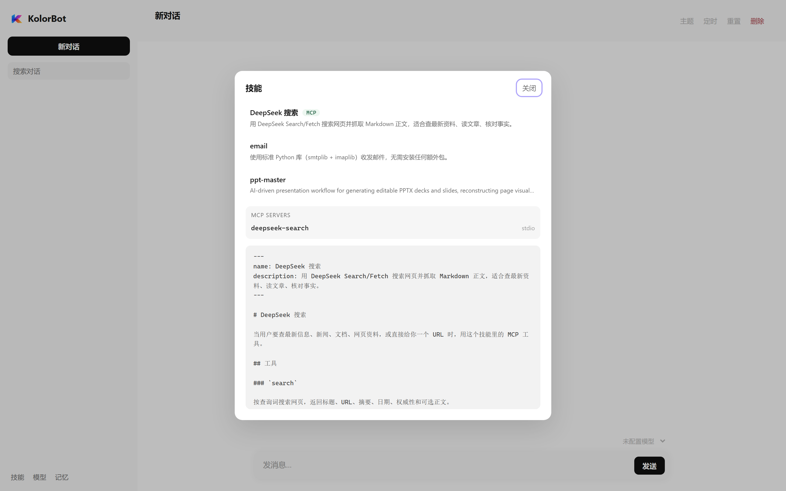

# KolorBot


KolorBot 是一个 Node.js 智能体（agent）运行时，带本地 Web 聊天界面。

> 新对话 / 交接请先读 [HANDOFF.md](HANDOFF.md)：包含项目结构、已完成改动、关键约束和运行方式。

模型不再写死成 DeepSeek，也没有内置默认模型：在 Web UI 左下角的「模型」页填入任意 OpenAI Chat Completions 兼容提供商的接口地址和 API Key，会自动识别该提供商的全部模型，然后在输入框上方的下拉框里选择使用。没有配置提供商时聊天会提示「没有可用模型」。

- **`kolor-agent-loop`** — 主循环：调用模型 → 执行工具 → 把结果写回会话 → 再调用模型，直到模型给出最终答复。可独立作为库使用。
- **`kolor-sessions`** — 会话存储：SQLite，默认 `~/.kolor/sessions.db`；支持会话主题、重置、定时任务、导出/导入上下文。
- **`kolor-skills`** — 技能发现：读取 `~/.agents/skills` 下 Claude 标准的 `SKILL.md`，生成 `<system-skills>` 列表。
- **`kolor-frame`** — **KolorFrame** 本地工具库：读写文件、列目录、执行 bash、读取技能详情；由 agent-loop 直接注册，不再是 MCP 进程。
- **`kolor-web`** — 本地 Web UI + HTTP API：聊天、会话、模型提供商、MCP 列表、技能。

只要传入 `apiUrl`、`apiModelName`、`apiKey` 就能跑；工具既可以在进程内注册，也可以来自任意 MCP 服务器。KolorFrame 的五个工具由 agent-loop 默认注册成本地工具，所以不配置 MCP 时 AI 也有文件/bash/技能能力。

## 目录

```
kolorbot/
├── package.json                 # pnpm workspace 根
├── HANDOFF.md                   # 交接文档（项目是什么 / 做过什么 / 怎么继续）
├── docs/web-ui.png              # 聊天 / 主题截图
├── docs/models.png              # 模型提供商截图
├── docs/memory.png              # 记忆（日记）截图
├── docs/schedule.png            # 定时任务截图
├── docs/skills.png              # 技能面板（含 MCP 标识与详情）
├── docs/tool-call.png           # 工具调用详情截图
├── docs/mobile.png              # 移动端抽屉截图
├── examples/skills/deepseek-search/  # 带 MCP 的搜索 / 抓取 skill
├── packages/
│   ├── kolor-agent-loop/        # 主循环
│   │   ├── src/agent.ts         # KolorAgent：turn/step、事件、取消、上下文导入
│   │   ├── src/context.ts       # 上下文校验
│   │   ├── src/session.ts       # 追加式会话日志
│   │   ├── src/llm/             # OpenAI 兼容流式客户端 + SSE 解析
│   │   ├── src/tools/           # 工具注册表 + 调度器（并行池 / 独占屏障）
│   │   └── src/mcp/             # MCP 客户端（stdio / Streamable HTTP / SSE）
│   ├── kolor-sessions/          # SessionStore（node:sqlite）
│   ├── kolor-skills/            # 技能发现 / <system-skills>
│   ├── kolor-frame/             # KolorFrame 本地工具库
│   └── kolor-web/               # Web 服务 + public/ 静态页面
│       ├── src/providers.ts     # 提供商存储（~/.kolor/providers.json）+ 模型发现
│       ├── src/runs.ts          # RunBroker：turn 生命周期 + 事件回放
│       ├── src/server.ts        # HTTP、SSE、API、调度器接线
│       └── public/              # index.html / app.js / styles.css
├── restart.cmd                  # 启停脚本入口（scripts/restart.ps1）
├── tsconfig.base.json
└── tsconfig.dev.json            # tsx 用的 paths（npm run web 直接跑源码）
```

## 快速开始

要求 Node.js >= 22.5（会话用 `node:sqlite`）。

```bash
pnpm install
pnpm build
pnpm test      # 141 个测试
pnpm demo      # 完全离线：本地假模型 + 本地工具
```

启动 Web UI：

```powershell
npm run web
# KolorBot web  http://127.0.0.1:3399
# 打开后在左下角「模型」页添加提供商（接口地址 + API Key）即可对话
```

`npm run web` 直接用 `tsx` 运行 TypeScript 源码（`tsconfig.dev.json` 把 `kolor-*` 包映射到各自 `src/`），**不再先逐个 build**；想跑编译后的产物用 `npm run web:dist`（等价于 `pnpm build && node packages/kolor-web/dist/src/bin.js`）。

想后台跑并方便重启，用仓库根目录的脚本（默认 `100.87.104.6:3399`，日志 `logs/kolor-web.log`）：

```powershell
.\restart.cmd                    # 停掉旧实例并后台拉起
.\restart.cmd status             # 端口 / PID / 模型
.\restart.cmd stop               # 只停
.\restart.cmd start -Foreground  # 前台跑，方便看报错
```

默认只监听 `127.0.0.1`。需要让局域网访问时用 `--host`：

```powershell
npm run web -- --host 0.0.0.0
# 或者：npm run web -- --host 0.0.0.0 --port 8080
```

也可以设置 `KOLOR_WEB_HOST=0.0.0.0`，命令行参数优先。`0.0.0.0` 会监听所有网卡；Web UI 没有鉴权，只建议在可信局域网使用。

打开 <http://127.0.0.1:3399>，在「模型」页添加一个提供商即可开始对话。启动日志里的 `model` 一行会显示当前用的提供商 / 模型；没配时显示「未配置」。

如果你更习惯用环境变量（例如 CI、容器），可以显式给出全部三项，它们会作为「环境变量 · 模型」出现在下拉框里：

```ts
{
  apiUrl: process.env.KOLOR_API_URL ?? '',      // 例如 'https://api.deepseek.com'
  apiModelName: process.env.KOLOR_API_MODEL ?? '', // 例如 'deepseek-chat'
  apiKey: process.env.DEEPSEEK_API_KEY ?? '',
}
```

三个都设置才会生效；只设置 key 不会产生任何默认模型。

### Web UI 能做什么



界面是白色极简风（纯白背景 + 浅灰层级），只保留对话需要的元素；模型思考时在回复位置显示三个跳动的点，出字后自动消失；操作结果用会自动消失的 toast 提示。



移动端顶部左右各有一个三条杠：左边打开对话列表，右边打开会话操作（主题 / 定时 / 重置 / 删除）。



- 会话：新建、切换、搜索、删除；历史存在 `~/.kolor/sessions.db`。
- 模型：侧栏「模型」管理提供商（OpenAI Chat Completions 协议），自动识别该提供商的全部模型；输入框上方的下拉框随时切换当前模型。详见 [模型提供商](#模型提供商)。
- 记忆：侧栏「记忆」管理日记——打开「定时追加日记」后，对话结束 10 分钟没有新消息就自动让 AI 追加当天日记；也可以发 `/update-daily-memory` 立即整理。详见 [记忆：日记](#记忆日记)。
- 主题与重置：会话可设置长文本主题，顶栏随时编辑；重置只清空上下文，名称和主题保留。设置主题或重置后的第一条用户消息会带上 `<system-topic>…</system-topic>`，之后恢复普通消息。
- 定时任务：会话设置里给单个会话挂任务，到点自动发送 `It's 2026/10/27 20:16:00 Tuesday. Do: 任务名` 并正常跑一轮；支持每天 / 每周（多选）/ 每月 / 每小时，每种规则都可以用 `+` 添加多个时间节点（多个时刻 / 日期 / 分钟）。模型也可以用 `schedule_reminder` 工具自己创建提醒；任务名要求 1-4 个词、最多 40 字符，只需要 AI 自己能识别。
- 技能：侧栏「技能」查看 `~/.agents/skills` 的 Claude 标准技能；对话开始、重置、或列表变化时，下一条消息前会带 `<system-skills>`，AI 用 `skills(id)` 工具读详情。
- 技能里的 MCP：有 MCP 的技能在列表里带一个 **MCP** 标识，点开技能详情就能看到它通过 `kolor.json` 声明的所有 MCP 服务器（名称 + transport）；单独的 MCP 页面已经去掉。
- 聊天：流式输出、工具调用卡片（参数 / 结果 / 状态，可折叠）、停止按钮、思考时的三个点。AI 回复**边出边渲染 Markdown**（标题、表格、列表、代码块、引用、链接、加粗、行内代码等）：最新一段文字保持淡入动画，其余已接收的部分立即转成渲染结果，不用等整条回复结束。
- 断线不丢回答：一轮对话在服务端跑，关闭标签页、刷新、切网都只是断开镜像；回来时会从服务端缓冲回放整轮，会话列表里正在跑的会话带一个跳动的点。同一会话同时只允许一轮，重复发送会返回 409 并自动接上看得到的那轮。
- 跟随滚动：只有当你离消息列表底部**一行字以内**时，新输出才会自动把视图拉到最底；往上翻读历史时不会被拽走，轮次结束重建消息也不会改变你的位置。
- 内置工具：`read_file` / `write_file` / `list_files` / `bash` / `skills` 由 agent-loop 直接注册，和 MCP 无关；额外 MCP 只能写在技能目录的 `kolor.json` 里。

| 环境变量 | 默认值 | 作用 |
| --- | --- | --- |
| `DEEPSEEK_API_KEY` / `KOLOR_API_KEY` | 空 | ① 给 `kolor.json` 里的 `${DEEPSEEK_API_KEY}` 占位符用（搜索技能）；② 显式环境变量回退的一部分 |
| `KOLOR_API_URL` | 空 | 显式环境变量回退的 endpoint；不设就没有任何默认模型 |
| `KOLOR_API_MODEL` | 空 | 显式环境变量回退的模型名；不设就没有任何默认模型 |
| `KOLOR_WEB_HOST` / `KOLOR_WEB_PORT` | `127.0.0.1` / `3399` | 监听地址与端口 |
| `KOLOR_HOME` | `~/.kolor` | 数据目录（`sessions.db`、`providers.json`、`memory.json`、`workspace/`） |
| `KOLOR_SESSIONS_DB` | `<home>/sessions.db` | 会话数据库 |
| `KOLOR_FRAME_ROOT` | `<home>/workspace` | 内置文件/bash 工具的工作区根 |
| `KOLOR_SKILLS_DIR` | `~/.agents/skills` | 技能目录（Claude 标准） |

> `KOLOR_API_URL`、`KOLOR_API_MODEL`、`DEEPSEEK_API_KEY` **三个都设置**时，才会出现「环境变量 · 模型」这个回退项；只设置 key 不会自动补 deepseek 端点。

> Web 服务没有鉴权，默认只监听 `127.0.0.1`，不要暴露到公网。

### 如何运行 TypeScript

项目是 TypeScript 源码 + `tsc` 编译到 `dist/`，三种跑法：

| 方式 | 命令 | 适用场景 |
| --- | --- | --- |
| 编译后运行 | `pnpm build && node dist/your-script.js` | 自己的入口脚本，走 `tsc`；`npm run web:dist` 也是这条 |
| Node 原生类型剥离 | `node your-script.ts` | Node ≥ 22.18 / 24；只支持可擦除语法，不能有 `enum`、`namespace`、参数属性 |
| tsx 直接跑源码（`npm run web` 用的） | `tsx --tsconfig tsconfig.dev.json packages/kolor-web/src/bin.ts` | 不改 `dist`、调试包的 TS 源码；`tsconfig.dev.json` 的 `paths` 把 `kolor-*` 映射到各自 `src/index.ts` |

**不能**直接用 `node packages/kolor-web/src/bin.ts`：源码用 NodeNext 约定（`import './agent.js'`），Node 原生剥离不会把 `.js` 映射回 `.ts`；走 `tsc` 或 `tsx`。

Node 24.13 在 Windows 上有个小 bug：`fetch` 之后若有未捕获异常退出，可能打印 `Assertion failed: ... uv_handle_closing`。把调用包进 `try/catch` 即可。

## 作为库使用

```ts
import { KolorAgent, defineTool } from 'kolor-agent-loop';

const agent = await KolorAgent.create({
  apiUrl: 'https://api.deepseek.com',
  apiModelName: 'deepseek-chat',
  apiKey: process.env.DEEPSEEK_API_KEY!,
});

for await (const event of agent.stream('列出当前目录并总结')) {
  if (event.type === 'text/delta') process.stdout.write(event.text);
  if (event.type === 'tool/result') console.log(`\n[tool] ${event.name} → ${event.content}`);
}
```

### 上下文导入 / 导出

```ts
// 从任意来源导入（会校验 tool call 配对）
agent.importContext(JSON.parse(fs.readFileSync('session.json', 'utf8')).context);

// 导出，可交给 kolor-sessions 落库
const context = agent.exportContext();
```

`KolorAgent.create(config, { context })` 也可以在创建时直接带入上下文。

### 自定义工具

```ts
const writeFile = defineTool({
  name: 'write_file',
  description: 'Write text to a file',
  inputSchema: {
    type: 'object',
    properties: { path: { type: 'string' }, text: { type: 'string' } },
    required: ['path', 'text'],
  },
  concurrency: 'exclusive', // 独占：与同一步的其他调用形成屏障
  execute: async (input, context) => ({ content: `wrote ${input.path}` }),
});
```

- `execute` 可以直接返回字符串；`isError: true` 让模型看到失败但不会中断本轮；`concludeTurn: true` 在该结果提交后结束本轮。
- 工具抛异常、参数不是合法 JSON、未知工具、超时，都会变成 `isError` 结果写回会话。
- 工具拿到 `context.signal`，超时/取消会中止；即使工具无视信号，调度器也会用硬超时竞速。

## kolor-agent-loop 配置

| 字段 | 默认值 | 说明 |
| --- | --- | --- |
| `apiUrl` | 必填 | Base URL；`.../v1`、`.../chat/completions` 都接受 |
| `apiModelName` | 必填 | 请求体里的 `model` |
| `apiKey` | 必填 | Bearer token，不会进日志或工具结果 |
| `systemPrompt` | 内置 | 传 `''` 关闭 system message |
| `maxSteps` | `40` | 单轮最多几次模型调用 |
| `maxParallelToolCalls` | `10` | 单步内并行工具上限 |
| `toolTimeoutMs` | `60000` | 单个工具默认超时 |
| `requestTimeoutMs` | `120000` | 单次模型请求超时 |
| `maxToolResultChars` | `100000` | 工具输出截断阈值 |
| `mcpServers` | `[]` | MCP 服务器列表 |
| `mcpDefaultConcurrency` | `parallel` | MCP 工具默认并发模式 |
| `mcpConnectTimeoutMs` | `20000` | MCP 握手 / `tools/list` 超时 |
| `agentId` | `kolor-agent` | 事件与工具上下文中的 agent 标识 |

## MCP 与内置工具

MCP 三种传输都支持：

```ts
mcpServers: [
  { name: 'fs', command: 'npx', args: ['-y', '@modelcontextprotocol/server-filesystem', '.'] },
  { name: 'remote', transport: 'http', url: 'https://example.com/mcp', headers: { authorization: 'Bearer …' } },
  { name: 'legacy', transport: 'sse', url: 'https://example.com/sse' },
]
```

工具名会变成 `mcp__<server>__<tool>`（例如 `calc` → `mcp__calc__add`）。单个服务器连不上不会让 agent 启动失败：`agent.mcpServers` 记录 `ok: false` 和原因，同时发出 `mcp/error` 事件。

KolorFrame 不是 MCP，也不额外启动进程：`KolorAgent` 默认把 `read_file`、`write_file`、`list_files`、`bash`、`skills` 注册成本地工具，工作区由 `kolorFrame.root` 指定（Web 默认 `~/.kolor/workspace`）。传 `kolorFrame: false` 可以关闭。

### 在 skill 里声明 MCP

Web 不再维护单独的 `mcp.json`。额外 MCP 写在技能目录的 `kolor.json`：

```md
~/.agents/skills/github/
├── SKILL.md
└── kolor.json
```

```json
{
  "mcpServers": {
    "github": {
      "command": "npx",
      "args": ["-y", "@modelcontextprotocol/server-github"],
      "env": { "GITHUB_TOKEN": "..." }
    },
    "browser": {
      "type": "http",
      "url": "https://example.com/mcp",
      "headers": { "Authorization": "Bearer ..." }
    }
  }
}
```

- `mcpServers` 是标准写法，也接受 `mcp` 作为别名。
- `kolor.json` 可以放在单个技能目录；也可以放在 `~/.agents/skills/kolor.json` 作为全局配置。根配置优先，然后按技能 id 排序。
- `stdio` 需要 `command`，默认 `cwd` 是技能目录；相对 `command` / `cwd` 按技能目录解析。
- `env` / `headers` 的值支持 `${VAR}` 占位符，从启动 `kolor-web` 的进程环境读取；适合注入 API key。`/api/mcp` 只返回名称、来源技能和传输方式，不会把 env/headers 回传给浏览器。
- `http` / `sse` 需要 `url`。
- 同名 server 先到先得，避免两个技能互相覆盖工具。
- Web 不再有单独的 MCP 页面：在侧栏「技能」里，带 MCP 的技能旁边有 **MCP** 标识，点开技能详情就能看到它声明的所有 server；改完文件后下一轮对话自动重连。

KolorFrame 提供：

| 工具 | 说明 |
| --- | --- |
| `read_file` | 按行读 UTF-8 文本 |
| `write_file` | 写/追加，自动建目录 |
| `list_files` | 递归列目录 |
| `bash` | 在工作区执行 shell 命令 |
| `skills` | 读取 `~/.agents/skills/<id>/SKILL.md` 和文件列表 |

文件工具只能在 `KOLOR_FRAME_ROOT` 内活动；`bash` 不沙箱（本地可信环境使用）。

## 模型提供商



侧栏左下角的「模型」页管理模型提供商。一个提供商就是一组 **接口地址 + API Key**，走 OpenAI Chat Completions 协议（DeepSeek、OpenAI、OpenRouter、vLLM、Ollama 的 `/v1` 等都适用）。

添加流程：

1. 填名称（可留空，默认用域名）、接口地址（如 `https://api.openai.com/v1`）、API Key（本地服务可留空）。
2. 点「添加并识别模型」：服务端请求 `GET <base>/models`，把返回的模型全部存下来；基于 `/v1` 的网关会先试 `<base>/models`，再试 `<base>/v1/models`。
3. 输入框上方的下拉框里出现 `提供商 · 模型`，选中即生效。第一个提供商添加后会自动选中它的第一个模型。

其它行为：

- 「刷新」重新识别模型列表；「删除」移除提供商。
- 没有 `/models` 接口的网关可以手动填模型名（逗号分隔），此时跳过识别。
- 识别失败会直接报错（例如 `返回 401 Unauthorized`），不会保存一个没有模型的提供商。
- 删除当前提供商、或在下拉框里选「环境变量」时，回退到显式配置的 `KOLOR_API_URL` + `KOLOR_API_MODEL` + key。**没有内置默认**：这三项没配全就没有可选项，聊天会提示添加提供商。
- 模型选择是全局的：切换后所有会话的下一轮都用新模型，进行中的轮次不受影响。切换模型会在该会话重建 agent（MCP 会重连）。

存储位置是 `~/.kolor/providers.json`，和 `sessions.db` 同级：

```json
{
  "version": 1,
  "active": { "providerId": "p_1a2b3c4d5e6f", "model": "gpt-4o-mini" },
  "providers": [
    {
      "id": "p_1a2b3c4d5e6f",
      "name": "OpenAI",
      "baseUrl": "https://api.openai.com/v1",
      "apiKey": "sk-...",
      "models": ["gpt-4o", "gpt-4o-mini"],
      "createdAt": "2026-11-01T09:00:00.000Z",
      "updatedAt": "2026-11-01T09:00:00.000Z"
    }
  ]
}
```

- **API Key 只存在这个文件里**（POSIX 上写 `0600`），接口只回传 `hasKey` 和 `••••最后四位`，永远不回传明文；会话数据库里也不会写 key。
- 接口地址会做归一化：粘贴 `.../chat/completions` 或 `.../models` 会去掉后缀，只保留根地址。
- 这是本机可信环境的单用户工具：`providers.json` 是明文的，不要把它放进公开仓库。
- `examples/skills/deepseek-search` 的 `${DEEPSEEK_API_KEY}` 仍然从**进程环境变量**读取，不会自动使用提供商里的 key。

## 记忆：日记



侧栏「记忆」是记忆功能的入口，第一个板块是**日记**。开关「定时追加日记」打开后：

1. 一轮对话结束后开始计时；**10 分钟内没有新消息**就替这个会话跑一轮「整理日记」，跟定时任务一样是没有 SSE 客户端的后台轮次。
2. 模型调用 `append_diary` 工具，把这段时间发生的事追加到当天的日记文件。
3. 之后每次发新消息，当天日记都会以 `<system-daily-memory>…</system-daily-memory>` 注入到用户消息前面；**和上次发送的版本没差异就不重复注入**（签名记在会话的 `daily_signature` 里，重置后清空，所以重置后的第一条会重新带上）。

也可以在输入框直接发送 `/update-daily-memory`：它会被替换成和自动触发**完全相同**的那条消息（同一段 `<system-daily-memory-task>` 提示词 + 同一行时间戳），所以页面上显示出来的也是 `It's 2026/11/05 19:45:00 Thursday. Update today's diary.`，不再显示命令本身。

日记文件在 workspace 下，按本地日期一天一个文件：

```text
~/.kolor/workspace/daily/2026-11-02.md
```

文件不存在时由工具创建，格式固定：

```markdown
# 2026-11-03

## Previous Topic

- 完成了记忆日记功能（开关、注入去重、手动整理）
- 验证了日记按天落盘

## 20:39

- 加入记忆衔接：当天第一次整理先概括上一篇
- 验证了 `## Previous Topic` 的结构

## 22:10

又补了一轮：确认第二天第一次整理会自动衔接。
```

**记忆衔接**：整理提示词是**固定的一段英文**（`<system-daily-memory-task>` 里），里面直接写了「如果今天还没有日记，就先看 `daily/` 里最近一篇更早的日记，概括成 2-4 条要点传 `previous_topic`」。模型自己判断是不是当天第一条并读上一篇，工具把 `previous_topic` 写成标题下的 `## Previous Topic` 小节，正文仍然是 `## 时:分`。同一天后续的整理不会再写这段，也不会接受新的 `previous_topic`。

提示词外面那一行普通消息才是页面上显示的，自动和手动完全一样：`It's 2026/11/05 19:45:00 Thursday. Update today's diary.`。

要点：

- 工具负责路径、`# 年-月-日` 标题、`## Previous Topic` 和 `## 时:分` 小节，模型只需要写内容；它不能把日记写到别的路径。
- 「上一篇」由模型按文件名日期自己找当前日期之前最近的一个 `YYYY-MM-DD.md`，不要求一定是昨天；一篇都没有时只写正文。
- 一次整理只追加一节，不会覆盖旧内容；文件是普通 Markdown，可以自己编辑、用 Git 管理或同步。
- 开关状态存在 `~/.kolor/memory.json`（`{ "version": 1, "diary": { "autoAppend": true } }`）。
- 没有新内容时提示词要求模型不写空小节（直接回复 `No new content.`）；如果模型确实什么都没写，服务端日志会记一条 `the diary turn finished without appending anything`。
- 计时只在 Web 进程存活时有效，重启后从下一轮对话重新开始；自动整理不会自我循环（日记轮次结束后不再触发下一次）。
- 定时任务、手动消息、日记轮次都会重新开始计时。

## 会话存储

`kolor-sessions` 的表结构：

```sql
CREATE TABLE sessions (
  id            TEXT PRIMARY KEY,
  name          TEXT NOT NULL,
  created_at    TEXT NOT NULL,
  updated_at    TEXT NOT NULL,
  message_count INTEGER NOT NULL,
  preview       TEXT NOT NULL,
  context_json  TEXT NOT NULL,   -- AgentMessage[]
  topic         TEXT NOT NULL DEFAULT '',   -- 长文本主题，重置后保留
  topic_pending INTEGER NOT NULL DEFAULT 0  -- 下一条用户消息是否携带主题
);
```

```ts
import { SessionStore } from 'kolor-sessions';

const store = new SessionStore();                            // ~/.kolor/sessions.db
const session = store.create({ name: '调试 KolorBot', topic: '编写葡萄云项目…' });

store.setTopic(session.id, '改成开发移动端');                // 下一条消息重新注入主题
const prepared = store.prepareUserMessage(session.id, '开始吧');
// prepared.content === '<system-topic>\n改成开发移动端\n</system-topic>\n\n开始吧'

store.replaceContext(session.id, agent.exportContext());     // 每轮结束保存
store.reset(session.id);                                     // 只清上下文，主题/名称保留
agent.importContext(store.require(session.id).context);      // 读回继续
store.exportJson(session.id);                                // 导出（含主题）
store.importJson(json);                                      // 导入为新会话
```

主题注入规则：设置主题、修改主题、重置会话之后，**下一条**用户消息会被包成：

```
<system-topic>
（主题全文）
</system-topic>

（用户原话）
```

注入后 `topic_pending` 清零，后续消息不再携带；主题本身一直保存在会话里。

上下文在读写时都会校验：每个 assistant `toolCalls` 必须有对应的 `tool` 结果，`toolCallId` 不能悬空或重复。

## 定时任务



会话设置里的「定时」可给单个会话挂任务。一个任务只有两项：**名字** 和 **时间规则**。

每种规则都可以用 **`+`** 添加多个时间节点（删除用每行右侧的 `×`，最后一行不可删）：

| 规则 | 说明 |
| --- | --- |
| 每天 | 多个 `HH:mm`，例如 `09:00`、`21:00` |
| 每周 | 可多选周几 + 多个 `HH:mm` |
| 每月 | 多个日期（1-31）+ 多个 `HH:mm`；当月没有某一天就跳过那一天 |
| 每小时 | 多个分钟（0-59），例如 `0`、`10`、`30`、`50` |

同一条规则里的多个节点是「或」的关系：任意一个时间点命中就触发；每小时规则在整点后这些分钟各触发一次。任务列表里的描述会自动合并，例如 `每天 09:00、21:00`、`每月 15、30 日 09:00、21:00`。

到点后向该会话发送：

```
It's 2026/10/27 20:16:00 Tuesday. Do: （任务名）
```

然后按正常 agent 轮次处理：MCP 工具、主题注入、上下文落库都会生效。

实现要点：

- 任务存在同一个 `sessions.db` 的 `session_tasks` 表，删除会话会级联删除任务。
- `kolor-web` 进程内 15 秒 ticker 检查一次；同一任务同一分钟只触发一次（`last_fired_at`）。
- 只在服务运行时触发，**不补跑**停机期间错过的任务。
- 会话正在跑另一轮时，这次触发会被跳过，避免并发写同一会话。
- 时间使用服务器本地时区；消息里的时间戳是实际触发时刻。
- 旧的单值字段（`time` / `day` / `minute`）仍然兼容，读取时自动转成数组。

```sql
CREATE TABLE session_tasks (
  id            TEXT PRIMARY KEY,
  session_id    TEXT NOT NULL REFERENCES sessions(id) ON DELETE CASCADE,
  name          TEXT NOT NULL,
  schedule_json TEXT NOT NULL,
  created_at    TEXT NOT NULL,
  last_fired_at TEXT
);
```

## Skills（技能）



技能放在 `~/.agents/skills/<id>/SKILL.md`，遵循 Claude 标准：

```md
---
name: PDF 处理
description: 提取、合并、拆分 PDF，填写表单，扫描件 OCR。
---

# PDF 处理

1. 用 pdftotext 提取文字……
```

注入规则：

- **对话刚开始**（会话还没有消息）、**刚重置**、或**技能列表与上次发送不同**时，下一条用户消息最前面会带：

```
<system-skills>
pdf - 提取、合并、拆分 PDF……
review - 按仓库规范审阅 diff……
</system-skills>

<system-topic>…</system-topic>   ← 如果主题待注入

（用户原话）
```

- 发送后把列表指纹（`v1:<sha1>`）记进会话的 `skills_signature`；之后普通消息不再重复携带。
- 重置会清空该指纹，所以重置后的第一条消息会重新注入。
- 列表为空时不注入空标签。
- AI 需要细节时调用内置的 `skills(id)` 工具，拿到完整 `SKILL.md` 和该技能的文件列表。

路径优先级：`KOLOR_SKILLS_DIR` → `~/.agents/skills`。Web 侧栏的「技能」可以直接查看已安装技能和内容；带 `kolor.json` 的技能会显示 **MCP** 标识，点开详情能看到它声明的所有 MCP server。

示例：[`examples/skills/deepseek-search`](examples/skills/deepseek-search) 是一个带 MCP 的搜索/抓取 skill，模型可以调用 `search` 搜索网页、`fetch` 读取 Markdown 正文；它通过 `kolor.json` 的 `${DEEPSEEK_API_KEY}` 占位符拿到宿主进程的 key。

## Web HTTP API

| 方法 | 路径 | 说明 |
| --- | --- | --- |
| GET | `/api/config` | 配置 + 当前模型 + MCP 列表 |
| GET/POST | `/api/providers` | 提供商列表（key 已脱敏）/ 添加并识别模型 |
| DELETE | `/api/providers/:id` | 删除提供商 |
| POST | `/api/providers/:id/models` | 重新识别该提供商的模型 |
| PUT | `/api/model` | 切换当前模型（`providerId` 传空串表示回到环境变量回退） |
| GET/PUT | `/api/memory` | 记忆设置（日记开关）+ 今日日记内容 / 切换开关 |
| GET/POST | `/api/sessions` | 列表（带 `running`）/ 新建 |
| GET/PATCH/DELETE | `/api/sessions/:id` | 读取（带 `running`）/ 改名 / 删除 |
| GET | `/api/sessions/:id/run` | 当前/刚结束的 turn 状态 + 已缓冲的事件 |
| GET | `/api/sessions/:id/stream?from=N` | SSE：从第 N 个事件起回放，并继续推送实时事件 |
| PUT | `/api/sessions/:id/context` | 替换上下文 |
| PUT | `/api/sessions/:id/topic` | 设置/清除主题（下一条消息注入） |
| GET/POST | `/api/sessions/:id/tasks` | 定时任务列表 / 新建 |
| DELETE | `/api/sessions/:id/tasks/:taskId` | 删除定时任务 |
| GET | `/api/skills` | 已安装技能列表 + 签名 + 每个技能的 `mcpServers` |
| GET | `/api/skills/:id` | 技能详情（SKILL.md + 文件列表 + `mcpServers`） |
| POST | `/api/sessions/:id/reset` | 重置：清空上下文，保留名称与主题；正在跑的 turn 会被丢弃（不写回上下文） |
| GET | `/api/sessions/:id/export` | 导出 JSON（含主题） |
| POST | `/api/sessions/import` | 从 JSON 新建 |
| GET | `/api/mcp` | skill 声明的 MCP 列表（只读；Web UI 已不再单独使用，信息并入技能详情） |
| POST | `/api/chat` | SSE 事件流（`ready`、`topic/applied`、循环事件、`session/saved`、`run/cancelled`）；turn 在 broker 里跑，断开不影响；同会话重复请求返回 409 |
| POST | `/api/chat/cancel` | 停止当前轮次 |

## 架构：从 dsh-agent-loop 抄了什么

| 这里 | dsh-agent-loop 对应物 | 做法 |
| --- | --- | --- |
| `SessionLog` | session 日志 + `deriveMessages()` | 追加式日志，请求全部从日志派生 |
| `ToolRegistry` | `ctx.tools` | 工具定义 + 执行模式 + 模型 schema |
| `tools/scheduler.ts` | `tool-calls.ts` | 有界并行池、独占屏障、按模型顺序提交、取消补 skipped 结果 |
| `KolorAgent` turn/step | `ReactLoopAgent` | `step/start`/`step/end` 配对、轮次级 `AbortController` |
| 上下文校验 | 会话恢复契约 | 导入时验证 tool call 配对，坏历史不发给模型 |
| MCP 命名空间 | DSH 工具命名约定 | `mcp__server__tool`，非法字符规范化 |

明确未实现：持久化写句柄与崩溃恢复、steering/followup 队列、上下文压缩、自动重试、MCP resources/prompts/sampling、子代理。

## 测试

```bash
pnpm test
```

共 141 个测试：

- `kolor-agent-loop`（41）：SSE 分片、流式工具调用拼装、并行/独占调度、取消、超时、上下文导入校验、真实 HTTP 假模型端到端。
- `kolor-sessions`（23）：CRUD、路径解析、持久化重开、导入导出、非法上下文、主题注入、重置、旧库迁移、定时规则/任务存储、技能签名、日记签名。
- `kolor-skills`（12）：frontmatter 解析、列表、描述回退、签名变化、详情与文件列表、`kolor.json` MCP 解析（含全局配置与 `${VAR}` 展开）、缺失目录。
- `kolor-frame`（7）：读写、目录、bash、skills 工具、越界路径、错误映射。
- `kolor-web`（58）：静态页、配置、会话 API（含主题/重置/定时任务）、只读 MCP 列表、技能 API、主题与技能注入、调度器、`schedule_reminder` 工具、CLI 参数、定时任务与内置工具的真实端到端对话；提供商存储/key 脱敏、模型发现（`/models` 与 `/v1/models` 回退、401、连接失败）、地址归一化、添加/刷新/删除提供商 API、用选中模型真实对话、没有内置默认模型；日记文件的创建/追加格式、固定的整理提示词、`## Previous Topic` 衔接、开关持久化、`/api/memory`、`<system-daily-memory>` 只在变化时注入、重置后重新注入、`/update-daily-memory`、以及 10 分钟静默后自动整理日记的真实端到端；运行中的 turn（断开后继续、晚加入回放、重复请求 409、取消、完成态保留、定时任务可见、reset 不被写回）。

全部测试不需要网络和 API key。
