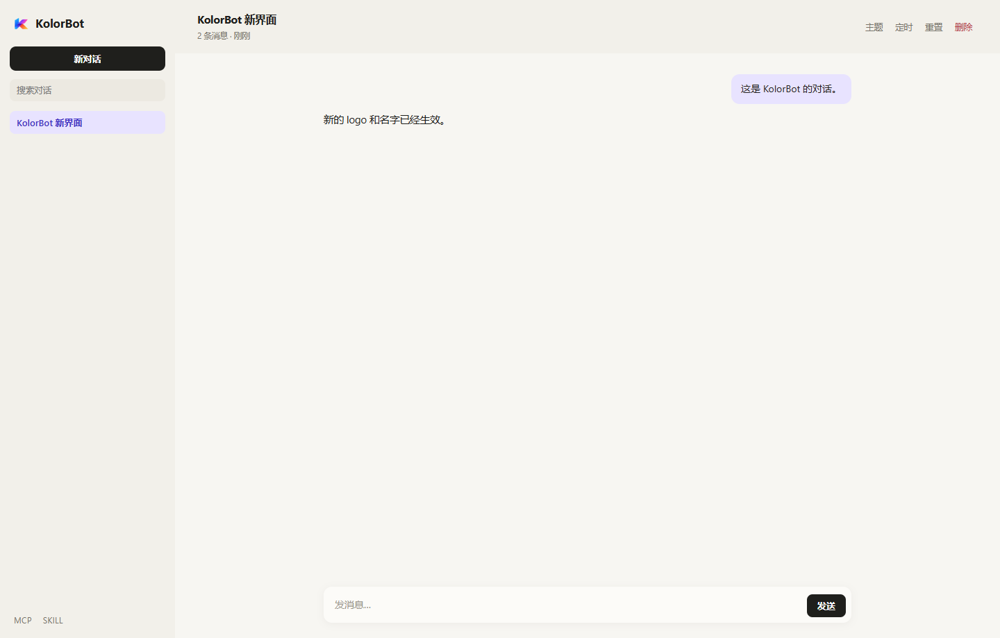
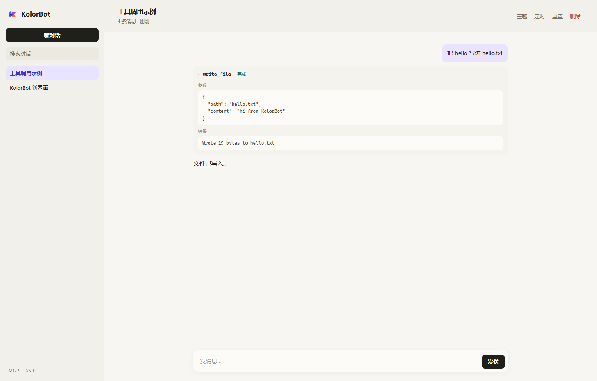
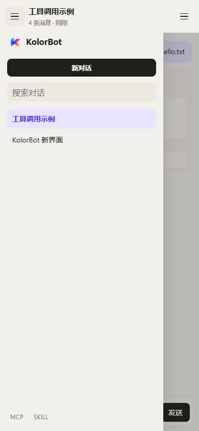
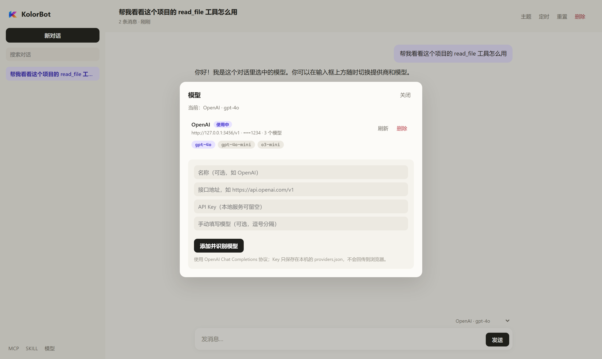
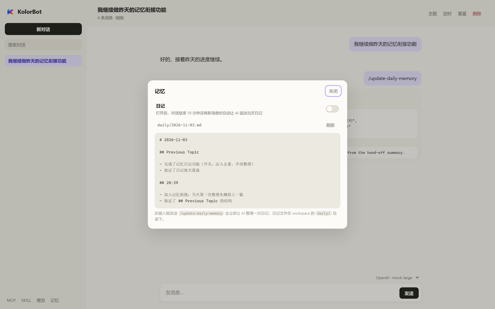
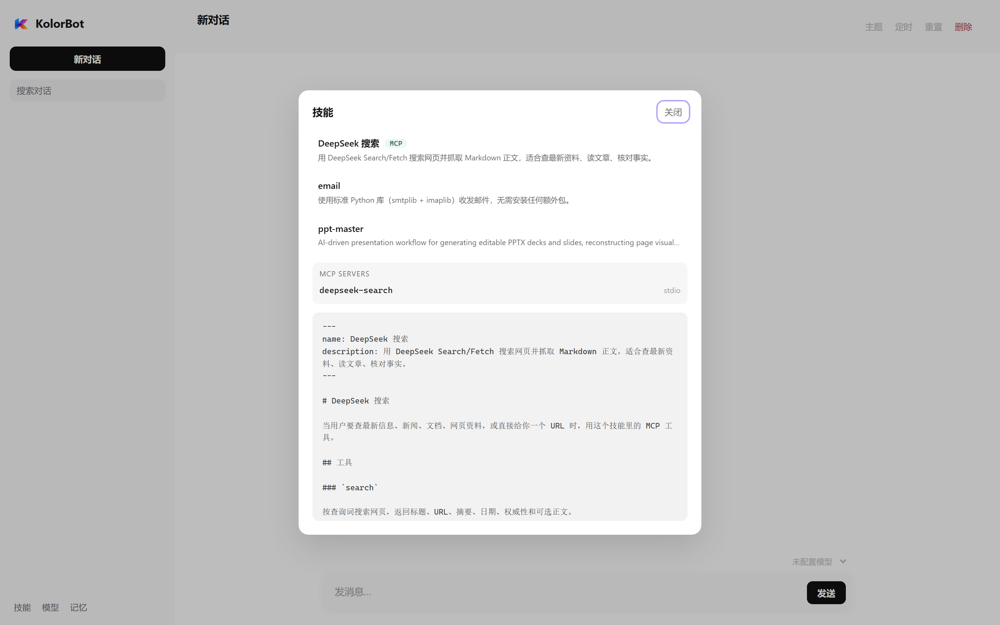

# KolorBot


KolorBot 是一个 Node.js 智能体（agent）运行时，带本地 Web 聊天界面。**整个应用只有一条对话**，这条对话会按「话题」自动分段：切换话题时插入分割线、切换上下文，并注入该话题的记忆。

当前版本：**0.4.0**（2026-11-14）。

> 新对话 / 交接请先读 [HANDOFF.md](HANDOFF.md)：包含项目结构、已完成改动、关键约束和运行方式。

模型不再写死成 DeepSeek，也没有内置默认模型：在 Web UI 左下角的「模型」页填入任意 OpenAI Chat Completions 兼容提供商的接口地址和 API Key，会自动识别该提供商的全部模型，然后在输入框上方的下拉框里选择使用。没有配置提供商时聊天会提示「没有可用模型」。

- **`kolorbot-agent-loop`** — 主循环 + 内置 KolorFrame 工具：调用模型 → 执行工具 → 把结果写回会话 → 再调用模型，直到模型给出最终答复。文件/目录/bash/技能/read_image 工具都在这个包里，可独立作为库使用。
- **`kolorbot-conversation`** — 单对话存储：SQLite 里的 topics / segments / messages；切换话题会新建 segment，模型上下文只取当前 segment。
- **`kolorbot-skills`** — 技能发现：读取三个技能区的 Claude 标准 `SKILL.md`，生成 `<system-skills>` 列表。
- **`kolorbot-memory`** — 记忆：AI.md 设定、时间戳话题记忆文件、`<system-memory>` / `<system-last-message>` 注入块。
- **`kolorbot-web`** — Web UI + HTTP API：聊天、话题判定、模型提供商、技能/MCP、话题记忆。

**话题规则**：每条用户消息都会先经过一次轻量话题判定（continue / switch / new）。切换话题时 UI 插入话题分割线，模型上下文从空开始，并在第一条消息里注入：

- `<system-memory>`：AI.md + `workspace/topic/<slug>/main.md` 关键记忆 + 最新一条时间戳记录；
- `<system-last-message>`：上一个话题最后 10 条 user/assistant 文本。

同一话题后续消息不重复注入，只有 AI.md 变更时才重新发送。定时任务功能已暂时移除。

只要传入 `apiUrl`、`apiModelName`、`apiKey` 就能跑；工具既可以在进程内注册，也可以来自任意 MCP 服务器。KolorFrame 的本地工具由 agent-loop 默认注册，所以不配置 MCP 时 AI 也有文件/bash/技能能力。

## 目录

```
kolorbot/
├── package.json                 # pnpm workspace 根
├── HANDOFF.md                   # 交接文档（项目是什么 / 做过什么 / 怎么继续）
├── docs/web-ui.png              # 聊天截图
├── docs/models.png              # 模型提供商截图
├── docs/memory.png              # 记忆（设定 + 话题记忆）截图
├── docs/skills.png              # 技能面板（含 MCP 标识与详情）
├── docs/tool-call.png           # 工具调用详情截图
├── docs/mobile.png              # 移动端抽屉截图
├── inner/skills/browseruse/     # 内置技能：带 MCP 的无头浏览器（实时画面 + WebMCP）
├── packages/
│   ├── kolorbot-agent-loop/     # 主循环 + src/frame/（KolorFrame 工具）
│   ├── kolorbot-conversation/   # topics / segments / messages（单对话）
│   ├── kolorbot-skills/         # 技能发现 / <system-skills>
│   ├── kolorbot-memory/         # AI.md + 时间戳话题记忆 + 注入块
│   └── kolorbot-web/            # Web 服务 + public/ 静态页面 + 话题判定
│       ├── src/topic-classifier.ts  # 每条消息的话题判定
│       ├── src/providers.ts     # 提供商存储（~/.kolorbot/providers.json）+ 模型发现
│       ├── src/runs.ts          # RunBroker：turn 生命周期 + 事件回放
│       └── public/              # index.html / app.js / styles.css
├── restart.cmd                  # 启停脚本入口（scripts/restart.ps1）
├── pnpm-workspace.yaml / pnpm-lock.yaml
├── tsconfig.base.json / tsconfig.dev.json
├── LICENSE                      # MIT
└── .gitignore
```

## 快速开始

要求 Node.js >= 22.5（会话用 `node:sqlite`）。

```bash
pnpm install
pnpm build
pnpm test      # 117 个测试
pnpm demo      # 完全离线：本地假模型 + 本地工具
```

启动 Web：

```powershell
npm run web
# 或
node packages/kolorbot-web/dist/src/bin.js run web --port 3399
```

`npm run web` 用 `tsx` 直接跑源码（`tsconfig.dev.json` 把 `kolorbot-*` 包映射到各自 `src/`），**不需要先 build**；编译产物用 `npm run web:dist`。

不显式传 `--port` 或 `KOLOR_WEB_PORT` 时，启动顺序是 **3399 → 3420 → 随机空闲端口**；显式指定端口时不回退，绑定失败就直接报错。

想后台跑并方便重启，用仓库根目录的脚本（默认 `100.87.104.6:3399`，不可用时自动换 `3420` 或随机端口，日志 `logs/kolorbot-web.log`）：

```powershell
.\restart.cmd                    # 停掉旧实例并后台拉起 Web
.\restart.cmd status             # 端口 / PID / 模型
.\restart.cmd stop               # 只停
.\restart.cmd start -Foreground  # 前台跑，方便看报错
```

默认只监听 `127.0.0.1`。需要让局域网访问时用 `--host`：

```powershell
npm run web -- --host 0.0.0.0
# 或者：npm run web -- --host 0.0.0.0 --port 8080
```

也可以设置 `KOLOR_WEB_HOST=0.0.0.0`，命令行参数优先。`0.0.0.0` 会监听所有网卡；Web UI 没有鉴权，只建议在可信局域网使用。

打开启动日志里的地址（默认优先 `http://127.0.0.1:3399`，不可用时是 `3420` 或随机端口），在「模型」页添加一个提供商即可开始对话。启动日志里的 `model` 一行会显示当前用的提供商 / 模型；没配时显示「未配置」。

如果你更习惯用环境变量（例如 CI、容器），可以显式给出全部三项，它们会作为「环境变量 · 模型」出现在下拉框里：

```ts
{
  apiUrl: process.env.KOLOR_API_URL ?? '',      // 例如 'https://api.deepseek.com'
  apiModelName: process.env.KOLOR_API_MODEL ?? '', // 例如 'deepseek-chat'
  apiKey: process.env.DEEPSEEK_API_KEY ?? '',
}
```

三个都设置才会生效；只设置 key 不会产生任何默认模型。

### Web UI 能做什么



界面是白色极简风（纯白背景 + 浅灰层级），只保留对话需要的元素；模型思考时在回复位置显示三个跳动的点，出字后自动消失；操作结果用会自动消失的 toast 提示。



移动端顶部左侧的三条杠打开侧栏菜单（品牌 + 对话/技能/模型）。



- **单对话**：整个产品只有一条对话，没有新建会话、会话列表或搜索；所有历史在 `~/.kolorbot/conversation.db`。
- **话题页**：对话标题左边的话题图标进入；直接显示所有月份日历（所有话题合并），紫色日期可点开当天**全部话题**的聊天记录和当天记忆。
- **话题分段**：每条用户消息先判定话题；切换时插入话题分割线并换新上下文。详见 [单对话、话题与记忆](#单对话话题与记忆)。
- 模型：侧栏「技能」下面的「模型」管理提供商（OpenAI Chat Completions 协议），自动识别该提供商的全部模型；输入框上方的下拉框随时切换当前模型。
- 设定：侧栏底部 agent 卡片的「⋯」→「设定」管理 AI.md，可用 `/self-md-update` / `/self-md-tell …` 创建或更新；页面不再显示日记项。
- 输入框输入 `/` 会弹出指令补全（`/self-md-update`、`/self-md-tell`、`/update-daily-memory`），点击自动填充。
- 技能：侧栏「技能」查看三个技能区的 Claude 标准技能；每个话题的第一条消息会带 `<system-skills>`，AI 用 `skills(id)` 工具读详情。
- 技能里的 MCP：有 MCP 的技能在列表里带一个 **MCP** 标识，点开技能详情就能看到它通过 `kolor.json` 声明的所有 MCP 服务器（名称 + transport）；**每个服务器旁边有「刷新」按钮，点击会关闭该 MCP 服务器并重新连接**。
- 聊天：流式输出、工具调用卡片（**默认折叠**，点开看参数 / 结果 / 状态）、停止按钮、思考时的三个点。运行中继续输入并按 Enter 会先排队，等这一轮结束后自动发出。每次工具调用前后的文字各自成段；AI 回复**边出边渲染 Markdown**。
- 断线不丢回答：一轮对话在服务端跑，关闭标签页、刷新、切网都只是断开镜像；回来时从服务端缓冲回放整轮。同一时间只允许一轮，重复发送返回 409。
- 跟随滚动：只有离消息列表底部**一行字以内**时才自动拉到底；往上翻读历史时不会被拽走。
- 内置工具：`read_file` / `write_file` / `list_files` / `bash` / `skills` / `read_image` 由 agent-loop 直接注册；话题记忆另有 `list_topics` / `read_today_memory` / `read_diary` / `write_diary` / `write_topic`。额外 MCP 只能写在技能目录的 `kolor.json` 里。

| 环境变量 | 默认值 | 作用 |
| --- | --- | --- |
| `DEEPSEEK_API_KEY` / `KOLOR_API_KEY` | 空 | ① 给 `kolor.json` 里的 `${DEEPSEEK_API_KEY}` 占位符用（搜索技能）；② 显式环境变量回退的一部分 |
| `KOLOR_API_URL` | 空 | 显式环境变量回退的 endpoint；不设就没有任何默认模型 |
| `KOLOR_API_MODEL` | 空 | 显式环境变量回退的模型名；不设就没有任何默认模型 |
| `KOLOR_WEB_HOST` / `KOLOR_WEB_PORT` | `127.0.0.1` / `3399` | 监听地址与端口；显式设置端口时不回退 |
| `KOLOR_HOME` | `~/.kolorbot` | 数据目录（`conversation.db`、`providers.json`、`memory.json`、`workspace/`） |
| `KOLOR_CONVERSATION_DB` | `<home>/conversation.db` | 单对话 / 话题数据库 |
| `KOLOR_FRAME_ROOT` | `<home>/workspace` | 内置文件/bash 工具的工作区根 |
| `KOLOR_SKILLS_DIR` | `~/.agents/skills` | 兼容技能区（Claude 标准） |
| `KOLOR_USER_SKILLS_DIR` | `<home>/skills` | 专属技能区（默认 `~/.kolorbot/skills`） |
| `KOLOR_BUILTIN_SKILLS_DIR` | `<repo>/inner/skills` | 内置技能区 |
| `BROWSERUSE_VIEW_PORT` | `9223` | browseruse 技能实时画面的端口（经 `kolor.json` 的 `${VAR}` 注入技能进程） |
| `BROWSERUSE_HEADLESS` | `true` | browseruse 技能用 `false` 时显示真实浏览器窗口 |

> `KOLOR_API_URL`、`KOLOR_API_MODEL`、`DEEPSEEK_API_KEY` **三个都设置**时，才会出现「环境变量 · 模型」这个回退项；只设置 key 不会自动补 deepseek 端点。

> Web 服务没有鉴权，默认只监听 `127.0.0.1`，不要暴露到公网。

> 2026-11-17 起默认数据目录改为 `~/.kolorbot`。当前机器的旧目录 `~/.kolor` 已迁移，备份在 `C:\Users\jiayi\.kolor.backup-20261117-190135`；应用不再读取旧目录。

### 如何运行 TypeScript

项目是 TypeScript 源码 + `tsc` 编译到 `dist/`，三种跑法：

| 方式 | 命令 | 适用场景 |
| --- | --- | --- |
| 编译后运行 | `pnpm build && node dist/your-script.js` | 自己的入口脚本，走 `tsc`；`npm run web:dist` 也是这条 |
| Node 原生类型剥离 | `node your-script.ts` | Node ≥ 22.18 / 24；只支持可擦除语法，不能有 `enum`、`namespace`、参数属性 |
| tsx 直接跑源码（`npm run web` 用的） | `tsx --tsconfig tsconfig.dev.json packages/kolorbot-web/src/bin.ts run web` | 不改 `dist`、调试包的 TS 源码；`tsconfig.dev.json` 的 `paths` 把 `kolor-*` 映射到各自 `src/index.ts` |

**不能**直接用 `node packages/kolorbot-web/src/bin.ts`：源码用 NodeNext 约定（`import './agent.js'`），Node 原生剥离不会把 `.js` 映射回 `.ts`；走 `tsc` 或 `tsx`。

Node 24.13 在 Windows 上有个小 bug：`fetch` 之后若有未捕获异常退出，可能打印 `Assertion failed: ... uv_handle_closing`。把调用包进 `try/catch` 即可。

## 作为库使用

```ts
import { KolorAgent, defineTool } from 'kolorbot-agent-loop';

const agent = await KolorAgent.create({
  apiUrl: 'https://api.deepseek.com',
  apiModelName: 'deepseek-chat',
  apiKey: process.env.DEEPSEEK_API_KEY!,
});

for await (const event of agent.stream('列出当前目录并总结')) {
  if (event.type === 'text/delta') process.stdout.write(event.text);
  if (event.type === 'tool/result') console.log(`\n[tool] ${event.name} → ${event.content}`);
}
```

### 上下文导入 / 导出

```ts
// 从任意来源导入（会校验 tool call 配对）
agent.importContext(JSON.parse(fs.readFileSync('session.json', 'utf8')).context);

// 导出，可交给 kolorbot-conversation 落库
const context = agent.exportContext();
```

`KolorAgent.create(config, { context })` 也可以在创建时直接带入上下文。

### 自定义工具

```ts
const writeFile = defineTool({
  name: 'write_file',
  description: 'Write text to a file',
  inputSchema: {
    type: 'object',
    properties: { path: { type: 'string' }, text: { type: 'string' } },
    required: ['path', 'text'],
  },
  concurrency: 'exclusive', // 独占：与同一步的其他调用形成屏障
  execute: async (input, context) => ({ content: `wrote ${input.path}` }),
});
```

- `execute` 可以直接返回字符串；`isError: true` 让模型看到失败但不会中断本轮；`concludeTurn: true` 在该结果提交后结束本轮。
- 工具抛异常、参数不是合法 JSON、未知工具、超时，都会变成 `isError` 结果写回会话。
- 工具拿到 `context.signal`，超时/取消会中止；即使工具无视信号，调度器也会用硬超时竞速。

## kolorbot-agent-loop 配置

| 字段 | 默认值 | 说明 |
| --- | --- | --- |
| `apiUrl` | 必填 | Base URL；`.../v1`、`.../chat/completions` 都接受 |
| `apiModelName` | 必填 | 请求体里的 `model` |
| `apiKey` | 必填 | Bearer token，不会进日志或工具结果 |
| `systemPrompt` | 内置 | 传 `''` 关闭 system message |
| `maxSteps` | `80` | 单轮最多几次模型调用 |
| `maxParallelToolCalls` | `10` | 单步内并行工具上限 |
| `toolTimeoutMs` | `120000` | 单个工具默认超时（bash 单独放宽到 10 分钟） |
| `requestTimeoutMs` | `300000` | 单次模型请求超时 |
| `maxToolResultChars` | `100000` | 工具输出截断阈值 |
| `mcpServers` | `[]` | MCP 服务器列表 |
| `mcpDefaultConcurrency` | `parallel` | MCP 工具默认并发模式 |
| `mcpConnectTimeoutMs` | `20000` | MCP 握手 / `tools/list` 超时 |
| `agentId` | `kolor-agent` | 事件与工具上下文中的 agent 标识 |

## MCP 与内置工具

MCP 三种传输都支持：

```ts
mcpServers: [
  { name: 'fs', command: 'npx', args: ['-y', '@modelcontextprotocol/server-filesystem', '.'] },
  { name: 'remote', transport: 'http', url: 'https://example.com/mcp', headers: { authorization: 'Bearer …' } },
  { name: 'legacy', transport: 'sse', url: 'https://example.com/sse' },
]
```

工具名会变成 `mcp__<server>__<tool>`（例如 `calc` → `mcp__calc__add`）。单个服务器连不上不会让 agent 启动失败：`agent.mcpServers` 记录 `ok: false` 和原因，同时发出 `mcp/error` 事件。

KolorFrame 不是 MCP，也不额外启动进程：`KolorAgent` 默认把 `read_file`、`write_file`、`list_files`、`bash`、`skills` 注册成本地工具，工作区由 `kolorFrame.root` 指定（Web 默认 `~/.kolorbot/workspace`）。传 `kolorFrame: false` 可以关闭。

### 在 skill 里声明 MCP

Web 不再维护单独的 `mcp.json`。额外 MCP 写在技能目录的 `kolor.json`：

```md
~/.agents/skills/github/
├── SKILL.md
└── kolor.json
```

```json
{
  "mcpServers": {
    "github": {
      "command": "npx",
      "args": ["-y", "@modelcontextprotocol/server-github"],
      "env": { "GITHUB_TOKEN": "..." }
    },
    "browser": {
      "type": "http",
      "url": "https://example.com/mcp",
      "headers": { "Authorization": "Bearer ..." }
    }
  }
}
```

- `mcpServers` 是标准写法，也接受 `mcp` 作为别名。
- `kolor.json` 可以放在单个技能目录；也可以放在 `~/.agents/skills/kolor.json` 作为全局配置。根配置优先，然后按技能 id 排序。
- `stdio` 需要 `command`，默认 `cwd` 是技能目录；相对 `command` / `cwd` 按技能目录解析。
- `env` / `headers` 的值支持 `${VAR}` 占位符，从启动 `kolorbot-web` 的进程环境读取；适合注入 API key。`/api/mcp` 只返回名称、来源技能和传输方式，不会把 env/headers 回传给浏览器。
- `http` / `sse` 需要 `url`。
- 同名 server 先到先得，避免两个技能互相覆盖工具。
- Web 不再有单独的 MCP 页面：在侧栏「技能」里，带 MCP 的技能旁边有 **MCP** 标识，点开技能详情就能看到它声明的所有 server；改完文件后下一轮对话自动重连。

KolorFrame 提供：

| 工具 | 说明 |
| --- | --- |
| `read_file` | 按行读 UTF-8 文本 |
| `read_image` | 读本地图片（PNG/JPEG/GIF/WebP/BMP），返回格式/尺寸；**支持视觉的模型会真正收到图片**（非视觉模型只拿到元数据，服务端自动降级） |
| `write_file` | 写/追加，自动建目录 |
| `list_files` | 递归列目录 |
| `bash` | 在工作区执行 shell 命令 |
| `skills` | 读取 `~/.agents/skills/<id>/SKILL.md` 和文件列表 |

文件工具只能在 `KOLOR_FRAME_ROOT` 内活动（`read_image` 也可以读三个技能区，方便看截图）；`bash` 不沙箱（本地可信环境使用）。

## 模型提供商



侧栏「模型」页管理模型提供商。一个提供商就是一组 **接口地址 + API Key**，走 OpenAI Chat Completions 协议（DeepSeek、OpenAI、OpenRouter、vLLM、Ollama 的 `/v1` 等都适用）。

添加流程：

1. 填名称（可留空，默认用域名）、接口地址（如 `https://api.openai.com/v1`）、API Key（本地服务可留空）。
2. 点「添加并识别模型」：服务端请求 `GET <base>/models`，把返回的模型全部存下来；基于 `/v1` 的网关会先试 `<base>/models`，再试 `<base>/v1/models`。
3. 输入框上方的下拉框里出现 `提供商 · 模型`，选中即生效。第一个提供商添加后会自动选中它的第一个模型。

其它行为：

- 「刷新」重新识别模型列表；「删除」移除提供商。
- 没有 `/models` 接口的网关可以手动填模型名（逗号分隔），此时跳过识别。
- 识别失败会直接报错（例如 `返回 401 Unauthorized`），不会保存一个没有模型的提供商。
- 删除当前提供商、或在下拉框里选「环境变量」时，回退到显式配置的 `KOLOR_API_URL` + `KOLOR_API_MODEL` + key。**没有内置默认**：这三项没配全就没有可选项，聊天会提示添加提供商。
- 模型选择是全局的：切换后所有会话的下一轮都用新模型，进行中的轮次不受影响。切换模型会在该会话重建 agent（MCP 会重连）。

存储位置是 `~/.kolorbot/providers.json`，和 `conversation.db` 同级：

```json
{
  "version": 1,
  "active": { "providerId": "p_1a2b3c4d5e6f", "model": "gpt-4o-mini" },
  "providers": [
    {
      "id": "p_1a2b3c4d5e6f",
      "name": "OpenAI",
      "baseUrl": "https://api.openai.com/v1",
      "apiKey": "sk-...",
      "models": ["gpt-4o", "gpt-4o-mini"],
      "createdAt": "2026-11-01T09:00:00.000Z",
      "updatedAt": "2026-11-01T09:00:00.000Z"
    }
  ]
}
```

- **API Key 只存在这个文件里**（POSIX 上写 `0600`），接口只回传 `hasKey` 和 `••••最后四位`，永远不回传明文；会话数据库里也不会写 key。
- 接口地址会做归一化：粘贴 `.../chat/completions` 或 `.../models` 会去掉后缀，只保留根地址。
- 这是本机可信环境的单用户工具：`providers.json` 是明文的，不要把它放进公开仓库。
- 技能 `kolor.json` 里的 `${DEEPSEEK_API_KEY}` 仍然从**进程环境变量**读取，不会自动使用提供商里的 key。

## 记忆：设定与话题记忆



agent 卡片的「⋯」→「设定」页面只显示 AI.md。记忆按当前话题注入：

```text
<system-memory>
## AI self (AI.md)

（AI.md 内容）

## Topic: 工作区 Remotion 环境

（workspace/topic/remotion/main.md 的内容）

## Latest record (2026-11-18-21-32.md)

（该话题最新一条时间戳记录）
</system-memory>
```

注入规则：

- 新话题第一条必发；
- 同一话题内只有 **AI.md 变化**才重发；话题记忆文件变化不会重发；
- 话题文件不存在时省略该段；AI.md 超过 1 MiB 会截断并标记。

### 设定（AI.md）

- 文件：`<workspace>/AI.md`，默认 `~/.kolorbot/workspace/AI.md`。固定头部格式：

```markdown
# 名字
## head-image
> 头像路径
```

`#` 后是名字，`## head-image` 下一行的 `>` 后是头像路径（相对 workspace 或绝对路径）。
- 只存：AI 的名字、性格、对自身的了解；可选：自己形象图片的本地路径、AI 认为自己形象是什么样。**超过 1 MiB 必须删减**。
- 更新命令：
  - `/self-md-update`：让 AI 以当前对话为信息创建/更新 AI.md；
  - `/self-md-tell 你是一个温柔的 AI…`：按命令后面的信息更新（没写内容会被拒绝）。
  两者都只发一条包含 AI.md 保存规则的消息，直接要求模型用 `write_file` 写 `workspace/AI.md`。

### 话题记忆整理

切换话题时自动整理上一个话题：

1. 上一段 segment 关闭后，服务端把这段对话记录整理成 transcript，交给一个**全新的整理 Agent**（新的临时 agent id、`context = []`，不复用当前对话 Agent）。
2. 该 Agent 只拿到这段 transcript、整理规则和写作工具；通过 `write_topic_note` 写当前话题的**每日记录**，不修改 `main.md` 关键记忆。
3. 如果同一话题跨了本地日期，第二天第一条消息会强制新开 segment，所以上一天会先被整理，不会因为话题没变而漏掉。
4. 记录路径：`workspace/topic/<slug>/<YYYY-MM-DD-HH-mm>.md`；关键记忆仍在同一目录的 `main.md`。
5. 文件名时间是**该 segment 最后一条消息的完成时间**，不是整理时间；跨天时以最后一条消息所在日期为准。
6. 记录内容是“做了什么、结果、进展”的正文，不写关键事实，不写 `# 日期`、`## 话题` 或 `### HH:mm`。
7. 同一话题有多个片段记录时，读取/展示会用 `---` 和 `### 片段 N · HH:mm` 分隔。
8. 整理任务不占用主对话、不阻塞新话题消息；整理 Agent 的上下文在任务结束后丢弃。
9. 旧的 `workspace/daily` 日记格式不再由整理任务写入；`write_diary` 只保留为旧工具兼容。

### 整理工具

- `write_topic_note({ content })`：把当前话题的**每日记录**写入 `workspace/topic/<slug>/<timestamp>.md`；只写做了什么，正文直接写入，不加标题/时间。
- `write_topic({ content })`：创建/替换当前话题的**关键记忆** `workspace/topic/<slug>/main.md`。
- `read_today_memory({ date? })`：扫描 `workspace/topic/<slug>/` 下所有话题的 `YYYY-MM-DD-HH-mm.md`，按时间排序返回；每条前带 `--------<slug>-HH-mm--------` 分隔线。
- `read_diary` / `write_diary` 是旧格式兼容工具；新的自动整理只使用 `write_topic_note`。

`write_topic_note` / `write_topic` 只在整理任务里启用；普通聊天中调用会返回错误，模型也不应再用 `write_file` 改 `topic/` 目录。

也可以发送 `/update-daily-memory` 立即整理（UI 会调用 `/api/diary/organize`，同样使用独立整理 Agent，不占用主对话）。

要点：

- 开关状态存在 `~/.kolorbot/memory.json`（`{ "version": 1, "diary": { "autoAppend": true } }`）。
- 切换话题触发的整理任务与主对话并行，但整理 Agent 的上下文在任务结束后丢弃；只有文件写入保留。
- 话题页补写也走同一个独立整理 Agent。

## 单对话、话题与记忆

### 存储

`~/.kolorbot/conversation.db`（`KOLOR_CONVERSATION_DB` 可覆盖）里有三张表：

```sql
topics          (slug, name, created_at, updated_at)
segments        (id, topic_slug, started_at, ended_at, memory_signature, diary_at)
messages        (id, segment_id, topic_slug, role, data_json, created_at)
```

整个应用只有一条对话；`segments` 是一次「话题访问」。切换话题（包括切回旧话题）会新建 segment，模型上下文只包含当前 segment 的消息。旧的多会话数据已归档到 `D:\deepseek_harness_workspace\backup\kolorbot-memory-2026-11-14`。

### 每条消息的话题判定

用户发出消息后，Web 用一次轻量模型调用判断：

```json
{"action":"continue"}
{"action":"switch","slug":"remotion"}
{"action":"new","name":"工作区 Remotion 环境","slug":"remotion"}
```

- 语义未变 → `continue`，继续当前 segment；
- 命中已有话题 → `switch`，复用原 slug / name；
- 新内容 → `new`，生成短名字和 ascii slug；
- 分类失败、超时、JSON 不合法 → 一律 `continue`；
- 话题不允许别名。

### 上下文与注入

切换话题后的第一条消息会带：

```text
<system-memory>
## AI self (AI.md)
...
## Topic: 工作区 Remotion 环境
workspace/topic/workspace-environment/main.md 的内容
## Latest record (2026-11-18-21-32.md)
最后一次时间戳记录的内容
</system-memory>

<system-last-message>
user: ...
assistant: ...
（上一个话题最后 10 条 user/assistant 文本）
</system-last-message>

（用户原话）
```

- 注入的是话题关键记忆 `main.md`，以及最新一条时间戳记录（只带最后一条，不是全部记录）；
- 新 segment 第一条必发 `<system-memory>` 和 `<system-last-message>`；
- 同一 segment 内只有 **AI.md 变化**才重发 `<system-memory>`；话题文件变化不会触发重发；
- `<system-last-message>` 只在新话题的第一条发送，且只算 user/assistant 文本。

### 每日记录格式

```text
workspace/topic/<slug>/<YYYY-MM-DD-HH-mm>.md
```

- 每个 segment 一条记录，文件名时间是该 segment 最后一条消息完成时间；
- 文件内容只写“做了什么、结果、进展”，不写关键事实；关键事实在 `main.md`；
- 文件本身不写日期/话题/时间标题；
- Web 的“当天记忆”会按片段编号加分割线：

```markdown
### 片段 1 · 21:02

...记录...

---

### 片段 2 · 21:05

...记录...
```

### 话题关键记忆

```text
workspace/topic/<slug>/main.md
```

```markdown
# 工作区 Remotion 环境

## 关键信息

- 项目路径：workspace/remotion-project
- 当前状态：...

## 待办 / 下一步

- ...
```

只放可复用事实、状态、决定和待办，不写流水账。注入时如果文件不存在就跳过该段。

## Skills（技能）



技能放在 `~/.agents/skills/<id>/SKILL.md`，遵循 Claude 标准：

```md
---
name: PDF 处理
description: 提取、合并、拆分 PDF，填写表单，扫描件 OCR。
---

# PDF 处理

1. 用 pdftotext 提取文字……
```

注入规则：

- **每个话题的第一条消息**（新 segment）最前面会带一次：

```
<system-skills>
pdf - 提取、合并、拆分 PDF……
review - 按仓库规范审阅 diff……
</system-skills>

（随后是 <system-memory> / <system-last-message>，最后是用户原话）
```

- 同一话题内不重复注入；切换话题会重新注入，因为上下文是新的。
- 列表为空时不注入空标签。
- AI 需要细节时调用内置的 `skills(id)` 工具，拿到完整 `SKILL.md` 和该技能的文件列表（三个区都会查）。

### 技能的三个区

Web 端把技能分成三个区，侧栏「技能」弹窗里也按这三个区分组展示（带数量；空区会显示目录提示）：

| 区 | 目录 | 说明 |
| --- | --- | --- |
| 兼容技能 | `~/.agents/skills`（`KOLOR_SKILLS_DIR` 可覆盖） | Claude 标准的兼容区，原来的安装位置 |
| 专属技能 | `<home>/skills`，默认 `~/.kolorbot/skills`（`KOLOR_USER_SKILLS_DIR` 可覆盖） | KolorBot 自己的技能区 |
| 内置技能 | 源码里的 `inner/skills`（`KOLOR_BUILTIN_SKILLS_DIR` 可覆盖） | 随源码分发的内置技能，`browseruse` 放在这里 |

- 三个区都按 `<区>/<id>/SKILL.md` 组织；同名技能按 **专属 → 兼容 → 内置** 的优先级取第一个，不会重复注入。
- 三个区的 `kolor.json` 都会被收集；同名 MCP server 同样按这个优先级取第一个。
- 改完技能文件不需要重启：下一轮对话重新读列表（列表指纹变化会触发重新注入和 MCP 重连）。

### Skill code 网页插件

技能可以在自己的目录里放一个浏览器 ES module。页面加载完成后，KolorBot 会请求 `/api/skill-code`，动态 import 每个入口并执行：

```text
<skill>/code/
├── index.js       # 必需；入口
├── helper.js      # 可选；index.js 可以相对 import
└── style.css      # 可选；一般用 addStyle 注入
```

入口写法：

```js
// <skill>/code/index.js
export default function activate(kb) {
  console.log('skill code loaded', kb.version);
}

// 也支持：
// export function activate(kb) {}
```

`kb` 就是 `window.KolorBot`。不要求打包工具，不能直接使用 npm 包；需要共享代码时用相对 import：

```js
import { renderHistory } from './history.js';
```

#### 最小页面示例

```js
export default function activate(kb) {
  kb.addStyle(`
    #my-demo-button { position: fixed; right: 20px; bottom: 20px; z-index: 60; }
    .my-demo-output { white-space: pre-wrap; padding: 20px; }
  `);

  const button = document.createElement('button');
  button.id = 'my-demo-button';
  button.textContent = '打开示例页';
  button.addEventListener('click', () => {
    kb.openPage({
      id: 'my-demo',
      title: '我的 Skill 页面',
      render(root) {
        const output = document.createElement('div');
        output.className = 'my-demo-output';

        const input = document.createElement('textarea');
        const send = document.createElement('button');
        send.textContent = '发送';

        send.addEventListener('click', async () => {
          output.textContent = '';
          try {
            await kb.sendMessage(input.value, {
              onEvent(event) {
                if (event.type === 'text/delta') {
                  output.textContent += event.text;
                }
                if (event.type === 'tool/call') {
                  output.textContent += `\n[tool] ${event.name}\n`;
                }
              },
            });
          } catch (error) {
            output.textContent = `失败：${error.message}`;
          }
        });

        root.append(input, send, output);
      },
    });
  });
  document.body.append(button);
}
```

#### `window.KolorBot` 完整 API

| API | 返回值 | 说明 |
| --- | --- | --- |
| `version` | `string` | 当前插件 API 版本，目前为 `1.0` |
| `getConversation()` | `Promise<Conversation>` | 读取 `topics` / `segments` / `messages`；即 `/api/conversation` 的 `conversation` |
| `getMessages()` | `Promise<StoredMessage[]>` | 扁平消息列表，最新在后 |
| `getModels()` | `Promise<ModelsPayload>` | 提供商、可用模型、当前 active 模型和默认环境模型 |
| `selectModel(providerId, model?)` | `Promise<ActiveModel>` | 切换全局模型；等同于侧栏模型下拉 |
| `getPersona()` | `Promise<{ name, headImage, avatarUrl }>` | 人设名字、原始头像配置和可访问的头像 URL |
| `getAvatar()` | `Promise<Blob \| null>` | 头像图片二进制；没有头像时为 `null` |
| `getState()` | `object` | 当前页面快照：`page` / `currentTopic` / `conversation` / `running` |
| `sendMessage(text, options?)` | `Promise<{ text, events, error }>` | 发送一轮消息并接收实时 SSE |
| `subscribe(listener)` | `() => void` | 订阅当前页面看到的所有运行事件；返回取消函数 |
| `on(type, listener)` | `() => void` | 只订阅指定事件类型；返回取消函数 |
| `openPage(options)` | `{ root, close, setTitle }` | 打开全屏插件页；浏览器 Back 可关闭 |
| `closePage()` | `void` | 关闭当前插件页 |
| `navigate(hash)` | `void` | 跳转页面，例如 `kb.navigate('#/chat')` |
| `addStyle(css)` | `() => void` | 插入 `<style>`；返回移除函数 |
| `addScript(code)` | `() => void` | 插入内联 `<script>`；返回移除函数 |
| `setGlobal(name, value)` | `() => void` | 设置 `window[name]`；返回移除函数 |

**`sendMessage(text, options)`**

```js
const result = await kb.sendMessage('帮我看看工作区', {
  signal: abortController.signal,
  onEvent(event) {
    // 收到每个 SSE 事件
  },
});
```

- 直接请求 `/api/chat`，和网页聊天使用同一个 `RunBroker`
- `onEvent` 收到的是原始 SSE 事件，不经 DOM 渲染
- 返回 `text`：本轮拼接后的 assistant 文本
- 返回 `events`：本轮收到的所有事件
- 返回 `error`：SSE 中出现 `web/error` / `agent/error` 时的错误文本，否则 `null`
- HTTP 409、模型未配置等错误会 throw
- 流结束后会刷新页面持有的 conversation 状态
- 也可以先选模型再发送：

```js
await kb.sendMessage('帮我看看工作区', {
  providerId: 'provider-id',
  model: 'deepseek-chat',
  onEvent(event) {
    // ...
  },
});
```

**选择模型**

`getModels()` 返回 `/api/providers` 的结构：

```js
const data = await kb.getModels();
// data = {
//   providers: [
//     { id, name, models: ['deepseek-chat', ...], ... }
//   ],
//   active: { source: 'provider' | 'env' | 'none', providerId, model, label },
//   defaults: { apiModelName, hasDefault, ... }
// }
```

选择一个提供商模型：

```js
await kb.selectModel('provider-id', 'deepseek-chat');
```

回到环境变量默认模型：

```js
await kb.selectModel('', '');
```

- `selectModel` 改的是**全局 active 模型**，和网页侧栏的模型下拉是同一个状态
- 不是“只对下一条消息生效”的隔离参数；并发发送时不要中途切换
- `sendMessage` 传 `providerId` / `model` 时，会先调用 `selectModel`，再发起这一轮
- `getModels()` 的 provider `apiKey` 已脱敏，不会返回明文

**获取人设名字和头像**

```js
const persona = await kb.getPersona();
// {
//   name: 'KolorBot',
//   headImage: 'avatars/me.png',
//   avatarUrl: '/api/agent/avatar' // 远程头像则是 http(s) URL
// }

if (persona.avatarUrl !== '') {
  const img = document.createElement('img');
  img.src = persona.avatarUrl;
  img.alt = persona.name;
  document.body.append(img);
}

// 需要 Blob 时：
const blob = await kb.getAvatar();
if (blob !== null) {
  const url = URL.createObjectURL(blob);
  // 用完记得 URL.revokeObjectURL(url)
}
```

- `getPersona()` 对应 `/api/agent`
- `name` 已回退为 `KolorBot`
- `avatarUrl` 为空表示没有头像；远程头像直接是远程 URL，本地头像为 `/api/agent/avatar`
- `getAvatar()` 会读取图片并返回 Blob；没有头像或读取失败返回 `null`
- 头像文件由 AI.md 的 `## head-image` 指向

**`subscribe(listener)` / `on(type, listener)`**

```js
const off = kb.on('text/delta', (event) => {
  console.log(event.text);
});
// ...
off();
```

订阅回调收到的事件比 `sendMessage.onEvent` 多三个字段：

```js
{
  ...event,
  sessionId: 'main',
  source: 'web' | 'plugin',
  at: '2026-11-22T...'
}
```

- `source: 'web'`：来自网页聊天窗口的轮次
- `source: 'plugin'`：来自 `kb.sendMessage`
- 页面刷新后订阅会丢失，需要重新调用

**`openPage(options)`**

```js
const page = kb.openPage({
  id: 'history',
  title: '历史记录',
  hash: '#/plugin/history',  // 可选；默认 #/plugin/<id>
  render(root) {
    root.textContent = '页面内容';
  },
  onClose() {
    // 可选；关闭/浏览器返回时调用
  },
});

page.setTitle('新标题');
page.close();
```

- 页面是覆盖在 KolorBot 上的全屏层
- 会写入 URL hash，浏览器 Back 会关闭页面
- `root` 是你自己的 DOM 容器，不会自动清空
- 返回的 `close()` 会恢复到打开前的 hash
- 同一时间只保留一个插件页

**注入能力**

```js
const removeStyle = kb.addStyle('.my-class { color: red; }');
const removeScript = kb.addScript('window.myField = 123;');
const removeField = kb.setGlobal('myField', 123);
```

- `addStyle` / `addScript` / `setGlobal` 都返回移除函数
- `setGlobal` 的名字必须是合法 JS 标识符
- 这些 API 只是方便注入；插件本身已经运行在页面同源环境，也可以直接操作 DOM
- 不要把不可信 skill 放进技能目录；插件没有额外沙箱

#### SSE 事件

`sendMessage.onEvent` 和 `subscribe` 可能收到：

| 类型 | 说明 |
| --- | --- |
| `ready` | 本轮已接入，带 model/tools |
| `run/state` | 当前 run 状态 |
| `turn/start` / `turn/end` | 轮次开始/结束 |
| `step/start` / `step/end` | 模型 step 边界 |
| `text/delta` | assistant 文本增量，字段 `text` |
| `reasoning/delta` | 推理文本增量（模型支持时） |
| `tool/call` | 工具调用，常见字段 `name` / `arguments` / `callId` |
| `tool/result` | 工具结果，常见字段 `callId` / `content` / `isError` |
| `tool/skipped` | 取消时未执行的工具 |
| `agent/error` / `web/error` | 运行错误 |
| `run/cancelled` | 本轮被取消 |
| `topic/switch` | 话题切换 |
| `session/saved` | 消息落库 |

事件字段可能随事件类型变化；`text/delta` 的 `text` 是最常用的实时字段。

#### 目录与加载规则

- 只有 `code/index.js` 会被当成入口；没有这个文件就不会加载
- `code/` 下其他文件可以通过 `/skill-code/<id>/<file>` 读取
- 支持 `.js` / `.mjs` / `.css` / `.json` / `.svg` / `.png` / `.jpg` / `.webp`
- 页面加载时只加载一次；改完插件代码刷新页面即可
- 同一技能 id 按 **专属 → 兼容 → 内置** 的优先级只取一个
- 服务端对 `code/` 做了路径穿越检查，但不能阻止插件主动调用 API

服务端接口：

- `GET /api/skill-code`：列出带 `code/index.js` 的技能
- `GET /skill-code/<skill-id>/<file>`：只读该技能 `code/` 下的文件
- 插件运行在页面同源环境；技能代码属于本地可信代码，不要安装不可信技能

内置技能 [`inner/skills/browseruse`](inner/skills/browseruse) 是**浏览器操控**技能：通过 MCP 打开系统 Edge 的无头实例，AI 用 `browser_open` / `browser_snapshot` / `browser_click` / `browser_type` / `browser_press` / `browser_evaluate` 操作网页，浏览器画面在本地 `http://127.0.0.1:9223`（`BROWSERUSE_VIEW_PORT` 可改，`BROWSERUSE_HEADLESS=false` 可看真实窗口）以 MJPEG 实时显示。**`browser_snapshot` 把文本快照和截图合并**：除标题/URL/正文/元素序号外，还会把截图存进技能目录并返回 `` 和文件路径。**每个操作（打开/点击/输入/按键/执行 JS）都会自动附带一次 snapshot 和新截图**，截图按需展示（用户要截图或需要说明页面时才贴出来）；实时画面地址只在打开新网页后给一次（或用户主动问），文本快照够用时不额外读图。预览页支持鼠标/键盘/滚轮，**按住鼠标可以拖动网页元素**（滑块、画布、拖拽排序），触摸屏上单指上下滑动会滚动网页。还带 `browser_webmcp_list` / `browser_webmcp_call` 调用网页自己注册的 WebMCP 工具（需要 Chrome ≥ 149 开 WebMCP 特性，当前 Edge 157 尚未开放）。**预览页本身可以手动操作**：鼠标点击/双击/右键、按住拖动、滚轮、键盘直接转发到真实浏览器，顶部输入框回车可发送中文文字。依赖只有 `playwright-core`（技能目录内 `npm install`），复用系统 Edge、不用下载浏览器内核。


## Web HTTP API

| 方法 | 路径 | 说明 |
| --- | --- | --- |
| GET | `/api/config` | 配置 + 当前模型 + MCP 列表 + `conversationDbPath` |
| GET | `/api/conversation` | 单对话的 `topics` / `segments` / `messages` + 当前话题 |
| GET | `/api/calendar` | 所有话题合并后的对话日期 + 按月份分组的日历数据 |
| GET | `/api/days/:date` | 某一天所有话题的聊天片段和当天记忆 |
| GET | `/api/topics` | 所有话题 + 每个话题有记忆的天数 |
| GET | `/api/topics/:slug` | 该话题的对话日期、已有记忆日期和按月份分组的日历数据 |
| GET | `/api/topics/:slug/days/:date` | 该话题某天的聊天片段 + 当天话题记忆 + `hasDiary` |
| POST | `/api/topics/:slug/days/:date/diary` | 为这一天补写该话题记忆（异步 202） |
| POST | `/api/diary/organize` | 把所有未整理片段交给独立记忆 Agent（异步 202） |
| GET/POST | `/api/providers` | 提供商列表（key 已脱敏）/ 添加并识别模型 |
| DELETE | `/api/providers/:id` | 删除提供商 |
| POST | `/api/providers/:id/models` | 重新识别该提供商的模型 |
| PUT | `/api/model` | 切换当前模型（`providerId` 传空串表示回到环境变量回退） |
| GET/PUT | `/api/memory` | 记忆：AI.md 内容/大小/名字/头像路径 + 旧日记兼容数据 + 日记开关 |
| GET | `/api/agent` | Agent 名字、头像路径和 `avatarUrl` |
| GET | `/api/agent/avatar` | 读取 AI.md 指向的本地头像文件 |
| GET | `/api/skills` | 三个技能区的技能列表（`source` 区分区）+ 签名 + `roots` + 每个技能的 `mcpServers` |
| GET | `/api/skill-code` | 带 `code/index.js` 的浏览器插件技能列表 |
| GET | `/skill-code/:id/*` | 读取技能 `code/` 下的插件文件 |
| GET | `/api/skills/:id` | 技能详情（SKILL.md + 文件列表 + `mcpServers`） |
| GET | `/api/mcp` | skill 声明的 MCP 列表（只读；信息并入技能详情） |
| POST | `/api/mcp/:name/restart` | 关闭指定的 MCP 服务器并重新连接 |
| POST | `/api/chat` | SSE 事件流，body 只有 `{ text }`；服务端先判定话题，再开始 turn；重复请求 409 |
| POST | `/api/chat/cancel` | 停止当前轮次 |
| POST | `/api/message` | 外部发送消息 + 回调地址；AI 忙时 409；每个 context 和结束状态 POST 回 callback |
| GET | `/api/sessions/:id/run` | 兼容端点（`id` 固定 `main`）：当前/刚结束的 turn 状态 + 缓冲事件 |
| GET | `/api/sessions/:id/stream?from=N` | 兼容端点（`id` 固定 `main`）：SSE 回放 + 实时事件 |
| POST | `/api/sessions/:id/reset` | 清空当前对话的消息（话题与记忆文件保留） |

## 外部消息 + 回调

```http
POST /api/message
Content-Type: application/json

{
  "message": "帮我看一下工作区",
  "callbackUrl": "http://127.0.0.1:9000/hook"
}
```

- 成功启动返回 `202 { "accepted": true, "callbackUrl": "...", "message": "..." }`。
- AI 正在处理（Web `/api/chat`、闲置整理、另一个 `/api/message`）时返回 `409`，不会排队、不会发送。
- 没有可用模型返回 `400`。
- 实际发送走内部 `/api/chat`，因此仍然会做话题判定、注入记忆、写对话历史。
- 每次 AI 输出一段 assistant 文本（被工具调用或轮次结束切开）都会向 `callbackUrl` POST：

```json
{
  "type": "context",
  "last": false,
  "context": "这段 AI 输出",
  "text": "这段 AI 输出",
  "sequence": 1,
  "at": "2026-11-17T12:00:00.000Z"
}
```

- 轮次结束再 POST：

```json
{ "type": "done", "last": true, "status": "done", "text": "完整输出", "contexts": 1, "at": "..." }
```

- 最后一个回调（`done` / `error` / `busy`）都带 `last: true`；`context` 带 `last: false`。

- 失败回 `type: "error"`；取消时 `done.status` 为 `"cancelled"`；内部竞态忙回 `type: "busy"`。
- 回调按顺序发送，10 秒超时；回调失败只写服务端日志，不会中断 AI。
- `callbackUrl` 只接受 `http:` / `https:`。服务端没有 SSRF 防护，只应在可信环境使用。

## 架构：从 dsh-agent-loop 抄了什么

| 这里 | dsh-agent-loop 对应物 | 做法 |
| --- | --- | --- |
| `SessionLog` | session 日志 + `deriveMessages()` | 追加式日志，请求全部从日志派生 |
| `ToolRegistry` | `ctx.tools` | 工具定义 + 执行模式 + 模型 schema |
| `tools/scheduler.ts` | `tool-calls.ts` | 有界并行池、独占屏障、按模型顺序提交、取消补 skipped 结果 |
| `KolorAgent` turn/step | `ReactLoopAgent` | `step/start`/`step/end` 配对、轮次级 `AbortController` |
| 上下文校验 | 会话恢复契约 | 导入时验证 tool call 配对，坏历史不发给模型 |
| MCP 命名空间 | DSH 工具命名约定 | `mcp__server__tool`，非法字符规范化 |

明确未实现：持久化写句柄与崩溃恢复、steering/followup 队列、上下文压缩、自动重试、MCP resources/prompts/sampling、子代理。

## 测试

```bash
pnpm test
```

共 117 个测试：

- `kolorbot-agent-loop`（53）：SSE 分片、流式工具调用拼装、并行/独占调度、取消、超时、上下文导入校验、真实 HTTP 假模型端到端；KolorFrame 的读写、目录、bash、skills、`read_image`。
- `kolorbot-conversation`（5）：话题复用、segment 切换、消息持久化、最后 10 条文本、未知话题拒绝、默认数据目录。
- `kolorbot-skills`（14）：frontmatter 解析、列表、描述回退、签名变化、详情与文件列表、`kolor.json` MCP 解析、缺失目录。
- `kolorbot-memory`（11）：`<system-memory>` / `<system-last-message>`、话题文件、日记片段查找（今天→最近→最早）、1 MiB 截断、`/self-md-*` 命令、话题日记触发文案。
- `kolorbot-web`（34）：静态页/配置/单对话 API、话题判定与切换、跨天强制分段、话题记忆与上一话题最后 10 条注入、同一话题不重复注入、工具调用落库、`/api/memory`、独立整理 Agent（write_topic_note + 时间戳话题文件）、话题日历/当天片段 API、CLI 子命令、提供商存储与模型切换、外部消息回调、端口 3399 → 3420 → 随机回退、skill code 插件服务。

全部测试不需要网络和 API key。

## License

[MIT](LICENSE)
